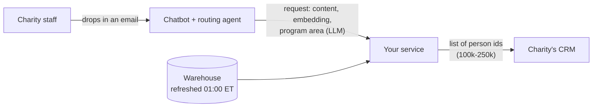

# Donor targeting platform

**Mock production project.** Practice taking an offline ML model and shipping it as a real
service under latency, memory, and data constraints.

A large charity sends email appeals to about 250,000 subscribers, and every email costs it
subscribers. The data science team has built a model that predicts who will donate to a given
email. **Your goal is to get that model into production**: a service that, a few minutes after a
charity staff member drops an email into the chatbot, sends the CRM the list of people who
should receive it.

Everything you need is in this repo, plus a synthetic copy of the charity's data warehouse that
`make data` downloads. The repo intentionally does **not** include a production API — that is
what you build.

- [Background](#background)
- [The existing work](#the-existing-work)
- [The product](#the-product)
- [Your task](#your-task)
- [Deliverables](#deliverables)
- [What good looks like](#what-good-looks-like)
- [Getting started](#getting-started)
- [How to sanity-check your audience](#how-to-sanity-check-your-audience)
- [Review with your mentor](#review-with-your-mentor)
- [FAQ](#faq)


## Background

- The charity emails its list twice a week (Tuesdays and Thursdays). Each email covers one of
**12 program areas**: clean water, disaster relief, education, and so on.
- **The business-as-usual (BAU) rule** is to send each email to a **random 75%** of the active
list. Nobody targets anything.
- **Every email causes churn.** Between 1% and 2% of recipients unsubscribe from each email (1.5%
on average), and an unsubscribed person can never be emailed again. In the six months of
history in this repo the charity lost **145,000 subscribers** to unsubscribes and only kept
its list size up by signing up about 5,000 new people a week.
- **The business goal is to reduce churn by not sending unnecessary emails**, without giving up
the donations the emails bring in (about 1.1% of emails lead to a gift; the median gift is
$45).


## The existing work

The data science team found that **people donate to content that looks like what they have
recently engaged with**:

1. For a send of email *c* to person *p*, take the content *p* opened or clicked in the 30 days
  before the send, and average its embeddings. This is `centroid_1m`, the person's recent
   taste.
2. The cosine similarity between `centroid_1m` and *c*'s embedding is
  `centroid_cosine_similarity`. It is NULL when *p* engaged with nothing in the last 30 days.
3. A logistic regression on that one feature (plus a was-NULL indicator) predicts whether the
  send leads to a donation. Out-of-time ROC AUC is 0.63.

The code is `donor_targeting/features.py` (features for a 60k-send sample),
`donor_targeting/ml_harness.py` (takes `X` and `y` DataFrames and returns a fitted model,
metrics and predictions) and `donor_targeting/train.py` (writes `models/donation_model.joblib`
and a model card).

`donor_targeting/baseline.py` replays targeting rules on historical sends. History was sent to
a random 75%, so it is an unbiased sample of the list. For each email, keep a share of its
recipients and count the donors and unsubscribes you would still get (`make baseline`):


| policy                  | emailed | precision (donation rate) | recall (donors reached) | $ recall | unsubscribes caused |
| ----------------------- | ------- | ------------------------- | ----------------------- | -------- | ------------------- |
| send to everyone        | 100%    | 1.15%                     | 100%                    | 100%     | 100%                |
| **BAU: random 75%**     | 75%     | 1.15%                     | 75.0%                   | 75.0%    | 75.0%               |
| engaged in last 30 days | 74.9%   | 1.22%                     | 79.7%                   | 79.6%    | 73.8%               |
| centroid top 75%        | 75%     | 1.24%                     | 81.0%                   | 81.2%    | 73.6%               |
| **centroid top 50%**    | 50%     | 1.51%                     | 65.8%                   | 63.7%    | 43.1%               |
| centroid top 25%        | 25%     | 2.18%                     | 47.2%                   | 46.0%    | 19.8%               |


For example, sending each email to the top half of the list by centroid similarity reaches 88%
of the donors BAU reaches while causing 43% fewer unsubscribes. Where to draw the line is a
business decision; the model only tells you the order.

**This works offline, on a 60,000-send sample, in a notebook-sized batch job. Nobody has run it
in production.**

## The product




1. A staff member at the charity drops the email they want to send into our chatbot.
2. A routing agent (already built; assume it works) embeds the content with the same model
  that produced `content.dense_embedding`, has an LLM classify its `program_area`, and calls
   your service with a request like `examples/requests/2003_clean_water.json`:
3. **Within 3 minutes of the request**, the list of people who should get the email must be
  in the CRM. That is typically **100,000 to 250,000 people**.


### Constraints


|          |                                                                                                                   |
| -------- | ----------------------------------------------------------------------------------------------------------------- |
| Latency  | The complete list is in the CRM within **3 minutes** of the request.                                              |
| Scale    | 100k–250k people per list; several staff members may send requests on the same day.                               |
| Hardware | A **Render background worker with 2 GB of RAM and 4 CPUs**. The 2 GB is a hard limit.                             |
| Data     | The warehouse is refreshed **every night at 01:00 ET**. Staff start using the product at **09:00 ET**.            |
| CRM      | The whole list goes to the CRM in a single request, which takes about 2 seconds (`donor_targeting/mocks/crm.py`). |


## Your task

**Build and deploy an API that receives the routing agent's request and meets the business
goal: the right list, in the CRM, within 3 minutes, on the hardware above.**

- **Serve the request.** Accept the request above (you design the response and any status
endpoint), decide the audience, and push it to the CRM.
- **Meet the business goal.** Decide who should *not* get the email. Document how you traded off
donations against churn and why.
- **Deploy it locally.** Provide one command that runs your service the way it would run on
Render (for example `docker compose up` with `--memory=2g --cpus=4`, or a documented `make`
target). A real cloud deployment is optional.
- **Mock anything you need.** The CRM, the warehouse, the routing agent, Render. Mocks for the
first two are in `donor_targeting/mocks/`, and `data/requests/` has 12 requests to replay.
- **Think about what data to persist**, where, and why.


## Deliverables

1. **Your code** (including how to run the service locally under the 2 GB / 4 CPU constraint).
2. A **`DESIGN.md`** at the repo root (about two or three pages) covering:
  - the architecture, and what happens at request time versus ahead of time;
  - the memory and latency budget for a 250k-person request, with numbers;
  - how you choose the audience, and your estimate of the donations it keeps and the
  unsubscribes it avoids compared with BAU;
  - what you persist and why;
  - what can go wrong in production and what your service does about it;
  - how you would know it works once it is live;
  - what you would do next with more time.
3. **Evidence** that your design meets the constraints — for example timing and peak memory for
  a 250k-person request.


## What good looks like

**Critical thinking over volume.** The quality of your decisions matters more than how much code
you write. A small system with well-reasoned trade-offs beats a large one that cannot explain
why it is shaped the way it is. Push back on the brief where you think it is wrong.

Work in a few focused sessions rather than rushing a single sitting. If you do not finish every
nice-to-have, say so in `DESIGN.md` and describe what you would build next — that is part of
the exercise.


## Getting started

You need [uv](https://docs.astral.sh/uv/getting-started/installation/), about 1 GB of free disk
and a machine with 8 GB or more of RAM.

```bash
make all    # install, download the warehouse (130 MB), features, model, baseline report
make test   # a few quick checks
```


| path                            | what                                                                          |
| ------------------------------- | ----------------------------------------------------------------------------- |
| `DATA_DICTIONARY.md`            | Tables, columns, refresh schedule, attribution rules. **Read this first.**    |
| `donor_targeting/config.py`     | Program areas, the snapshot time, paths.                                      |
| `donor_targeting/features.py`   | The DS team's feature pipeline (`centroid_1m`, `centroid_cosine_similarity`). |
| `donor_targeting/ml_harness.py` | `run(X, y)` returns a fitted model, holdout metrics and predictions.          |
| `donor_targeting/train.py`      | Trains the existing model into `models/`.                                     |
| `donor_targeting/baseline.py`   | Precision and recall of BAU against centroid targeting.                       |
| `donor_targeting/mocks/`        | A mock CRM and the warehouse as DuckDB.                                       |
| `examples/requests/`            | A sample chatbot request. All 12 are in `data/requests/` after `make data`.   |
| `ai_sessions/`                  | Optional log of AI-assisted work (see `ai_sessions/README.md`).               |


`make data` downloads `data/warehouse/` (timeline, transactions, content, people) and
`data/requests/`. `make features` adds `data/warehouse/features.parquet`. The snapshot is fixed,
so your baseline numbers should match `reports/baseline_report.md` after `make baseline`.

## How to sanity-check your audience

The dataset comes from a simulator, so in principle you could score any list by expected
donations and unsubscribes. **There is no automated grader in this repo** — in production you
would not have an oracle either. Sanity-check your audience the same way you would for real:

- Compare your targeting idea to BAU (random 75%) using the same metrics as
  `donor_targeting/baseline.py`: **donations and dollars kept** (your list vs BAU's share) and
  **unsubscribes avoided**.
- Replay the 12 requests in `data/requests/` through your service and inspect what lands in the
  mock CRM: no duplicate person ids, and everyone should be on the active list.
- Use historical sends (unbiased because they went to a random 75%) to backtest simple rules;
  `make baseline` shows how for a few policies.

## Review with your mentor

When you are ready, schedule a walkthrough. Plan to:

1. Demo the service end to end — ideally one of the larger lists (100k–250k people) within the
  latency budget.
2. Walk through `DESIGN.md`: architecture, memory/latency numbers, audience rule, and persistence.
3. Discuss trade-offs vs BAU using your estimates or baseline-style reasoning.
4. Explore a **what-if**: pick a changed constraint (half the RAM, slower CRM, model refresh) and
  explain how your design would adapt.

If you used AI coding tools, bring one example from `ai_sessions/` of something you verified or
corrected — see `ai_sessions/README.md`.

## FAQ

**Can I change or retrain the model?** Yes, if it serves the business goal and you explain why.
The main task is getting it into production, though, not squeezing out more AUC.

**Is the starter repo complete?** No. Feature training, mocks, and tests for the DS pipeline are
provided; **you** implement the production API and targeting path.
